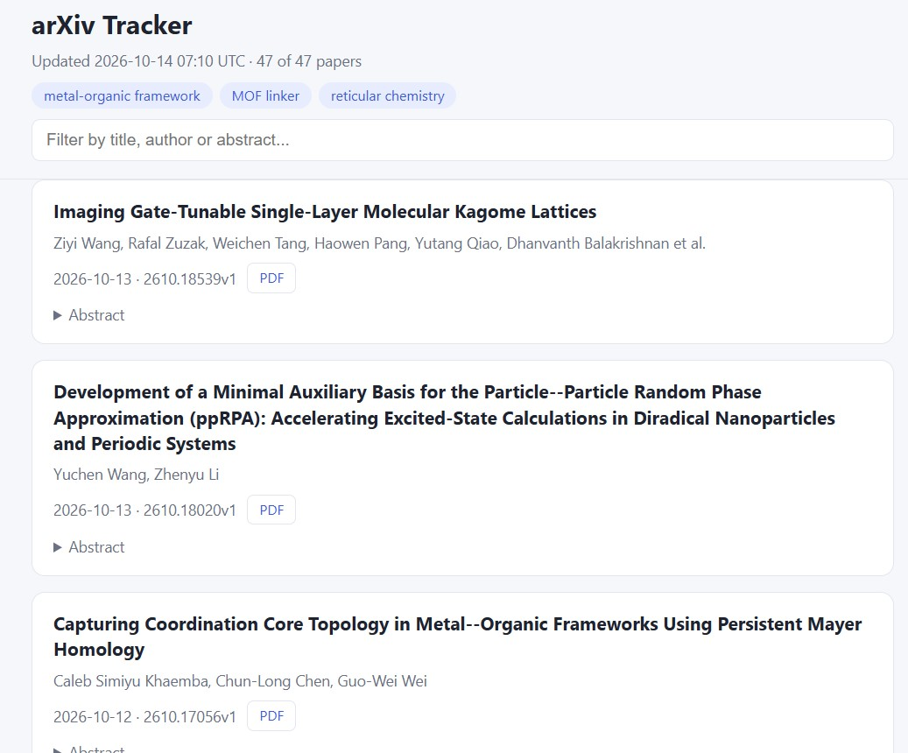

# arXiv Tracker

[](https://github.com/Beyza-KaraCE41/arxiv-tracker/actions/workflows/ci.yml)
[](https://github.com/Beyza-KaraCE41/arxiv-tracker/actions/workflows/deploy.yml)

A small tool that collects the latest arXiv papers on chosen topics and publishes
them as a static web page, rebuilt automatically every day with GitHub Actions.

**Live site:** https://beyza-karace41.github.io/arxiv-tracker/



## Features

- Searches arXiv for the keywords in `config.toml`
- Matches keywords word by word in titles and abstracts, ignoring case, hyphens
  and word order
- Marks papers that are new since the previous day's run
- Static page with search, collapsible abstracts, PDF links and dark mode
- No server or database: the site is rebuilt and published by GitHub Actions

## How it works

```
config.toml ──► fetch ──► filter ──► compare with yesterday ──► render ──► GitHub Pages
               (arXiv API)            (papers.json)            (index.html)
```

| Module | Responsibility |
|---|---|
| `config.py` | Reads keywords and settings from `config.toml` |
| `fetch.py` | Queries the arXiv API and parses the Atom feed |
| `text.py` | Splits text into normalized words for matching |
| `filters.py` | Keeps matching papers, removes duplicates, sorts newest first |
| `history.py` | Loads yesterday's paper IDs and finds new ones |
| `render.py` | Builds the HTML page (all external text is HTML-escaped) |
| `__main__.py` | Runs the steps above in order |

## CI/CD

Two GitHub Actions workflows live in `.github/workflows/`:

- **`ci.yml`** runs on every pull request and every push to `main`:
  lint (`ruff check`), format check (`ruff format --check`) and tests (`pytest`).
  `main` is protected, so a pull request cannot be merged until this check passes.
- **`deploy.yml`** runs every day at 05:17 UTC, after every push to `main`,
  and on demand. It runs the tests, builds the site and publishes it to GitHub Pages.
  If the tests fail, nothing is deployed.

Tests never call the real arXiv API: they use a saved sample feed and mocked HTTP
requests, so they are fast and give the same result every time.

## Run locally

Requires Python 3.11+.

```bash
git clone https://github.com/Beyza-KaraCE41/arxiv-tracker.git
cd arxiv-tracker
python -m venv .venv
source .venv/bin/activate        # Windows: .venv\Scripts\Activate.ps1
pip install -e ".[dev]"

python -m arxiv_tracker          # writes site/index.html
pytest                           # run the tests
ruff check . && ruff format --check .
```

## Configuration

```toml
[search]
keywords = ["metal-organic framework", "MOF linker", "reticular chemistry"]
max_results = 50

[site]
url = "https://beyza-karace41.github.io/arxiv-tracker/"   # optional, enables "New" badges
```

## License

MIT
